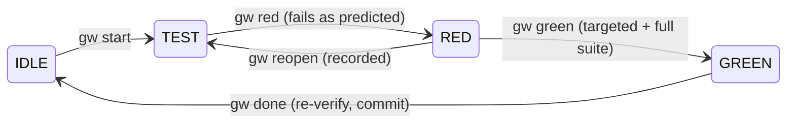

# Gewu Harness · 格物致知

**A lean Claude Code harness for every project: follow the SDLC loop, and prove every change red before green.**

[](https://github.com/yuanliang/gewu-harness/actions/workflows/ci.yml)
[](LICENSE)


English | [简体中文](README.zh-CN.md)

Gewu installs into any Git repository and does two things:

1. **It runs the SDLC loop** from Anthropic's [AI-native SDLC playbook](https://claude.com/resources/articles/the-ai-native-sdlc-playbook): plan → design → build → test → deploy → maintain, with a committed artifact at each stage and a human at each gate.
2. **It enforces one rule** with hooks and computed evidence, not with prompts:

> **No behavior change without a check that was first observed failing.**

Everything else, such as linters, design systems, deployment and team policies, is yours to plug in on top (see [Extending](#extending)).

*Gewu* (格物致知, "investigate things to reach knowledge"): you know something by examining the thing itself, not by trusting claims about it.

> **Status:** 0.x and early. The core is small and well tested, but commands and file formats may still change between minor versions. Read the [changelog](CHANGELOG.md) before upgrading.

## Why

Agents write code faster than anyone can verify it. The usual failure is not bad code but *unverified* code: tests written afterwards that pass vacuously, tests quietly edited until they go green, "done" reported without evidence. Gewu makes the honest path the shortest one:

- **Red before green.** A new check must fail, for the reason you predicted, before implementation unlocks.
- **Tests freeze at red.** After red the agent changes code, not tests. Fixing a wrong test is an explicit, recorded `reopen`.
- **Proof is computed.** `gw` runs the checks itself, snapshots the tree between steps, commits `[red]` and `[green]`, and CI replays every red from history.
- **Humans decide.** You approve the intent, spec and plan, and Claude must ask before every push, PR, merge or release.

## Quick start

**Requirements**

- macOS or Linux. On Windows, use [WSL](https://learn.microsoft.com/windows/wsl/), because checks run through `/bin/sh`.
- Node.js 18 or newer, and Git.
- Claude Code 2.1.295 or later. The edit guard relies on the hooks' `onFailure` setting, added in that version; on older versions a guard that crashes may let the edit through. `gw doctor` checks your version.

```bash
git clone https://github.com/yuanliang/gewu-harness.git
node gewu-harness/install.mjs /path/to/your/project
cd /path/to/your/project
.harness/gw doctor --run

# Review what was added, then commit it so teammates and CI share the same guardrails
git status
git add .harness .claude .github CLAUDE.md REVIEW.md .gitignore
git commit -m "chore: install Gewu Harness"
```

Restart Claude Code in the project and say what you want in plain language, for example:

> Add pagination to the orders API and keep the old endpoint working.

Claude drafts the intent, spec and plan for your approval, then works through red → green cycles and stops before any push.

- **Upgrade:** run the installer again. Files you own are merged (`CLAUDE.md`, `.claude/settings.json`, `.gitignore`) or left alone (config, review policy, CI), never overwritten.
- **Uninstall:** `node gewu-harness/install.mjs --uninstall /path/to/your/project` reverses exactly what was installed. Files you changed and your work records in `docs/work/` are kept.

## How it works

### The loop

| Stage | Skill | Artifact in `docs/work/<id>/` | Gate |
|---|---|---|---|
| Plan | `/gw-intent` | `intent.md`: problem, outcome, *falsifiable* acceptance signals | you approve |
| Design | `/gw-spec` | `spec.md`: every requirement has a Given/When/Then check | you approve |
| Build | `/gw-plan` → `/gw-build` | `plan.md`: ordered red → green cycles, each with a predicted failure | you approve |
| Test | built into every cycle; `/gw-fix` for bugs | `evidence.jsonl` and `evidence.md` | `gw audit` |
| Deploy | `/gw-review` → `/gw-ship` | independent review against `REVIEW.md`; PR draft | you approve each push / PR / merge |
| Maintain | `/gw-incident` | a failing reproduction, a lesson, a new intent | |

Work scales with its size: a bug needs only an approved intent, and a `quick` item needs none. Not sure what comes next? `/gw-next`.

### One cycle



| Phase | Tests | Source | What must hold to leave it |
|---|---|---|---|
| IDLE | locked | locked | `start`: without `--check`, the full suite must already be green |
| TEST | writable | locked | `red`: a test changed, the check fails, and it fails as predicted. A crash counts only with `--expect`; a check that cannot run never counts |
| RED | **frozen** | writable | `green`: tests untouched since red, targeted check and full suite pass |
| GREEN | **frozen** | writable | `done`: still green after refactoring |

Hooks enforce the locks on `Edit`, `Write` and shell writes. A test changed any other way is caught at `green` by the tree snapshot (`E_TAMPER`).

### Evidence you can audit

- `[red]` commits hold only the new tests; `[green]` commits hold the implementation and the evidence ledger.
- `gw audit --base main` flags any source change on the branch that no cycle verified.
- `gw audit --replay` re-runs every red at its own commit in a temporary worktree, confirms it really failed, and confirms HEAD is green. Your checkout is never switched. A hand-edited ledger fails replay. The installed CI workflow runs this on every pull request.

## Commands

The agent runs these for you; you rarely type them yourself.

| Command | What it does |
|---|---|
| `gw start <R#> "<behavior>" [--check <cmd>] [--expect <text>]` | Open a cycle (TEST) |
| `gw red [--expect <text>] [--adopt <test>]` | Prove the new check fails; freeze tests; `[red]` commit |
| `gw green` | Prove it passes: targeted check, then full suite |
| `gw done` | Re-verify after refactoring, write evidence, `[green]` commit |
| `gw reopen "<why>"` · `gw abort "<why>"` | Fix a wrong test (back to TEST) · abandon the cycle |
| `gw chore "<why>"` | Non-behavioral change; asks you; closes on a green full suite |
| `gw new "<title>" [--type feature\|bug\|incident\|quick]` · `gw use <id>` | Work items |
| `gw approve <intent\|spec\|plan>` | **Yours:** approve the exact current content, as `! .harness/gw approve plan` |
| `gw status` · `gw evidence` · `gw check` · `gw doctor [--run]` | Inspect |
| `gw audit [--base <ref>] [--replay]` | CI gate |

Errors carry a stable code (`E_NOT_RED`, `E_WRONG_REASON`, `E_TAMPER`, `E_REGRESSION`, `E_GATE`, …) and say what to do next.

## Configuration

`.harness/config.json`:

| Key | Default | Meaning |
|---|---|---|
| `verify` | detected | Full-suite command; exit 0 is green. Detects npm, pnpm, yarn, bun, pytest, Go, Cargo, Mix, RSpec, Maven, Gradle, SwiftPM and Make |
| `language` | from your locale | Language of the work-item templates: `en` or `zh-CN` |
| `enforce` | `strict` | `strict` blocks; `warn` only tells the agent; `off` disables the hooks |
| `gates` | `warn` | `strict` makes `start` require approved, unchanged documents |
| `commit` | `true` | Make `[red]` / `[green]` commits of exactly the cycle's files |
| `replaySetup` | `null` | Prepares replay worktrees, for example `npm ci`; required when dependencies live outside git |
| `postEdit` | `null` | Run after each edit, for example `npx prettier --write {file}` |
| `testGlobs` / `freeGlobs` / `guardGlobs` | see file | How files are classified as tests, free (docs) or guardrails |

## Extending

The core stays small on purpose. Add capabilities with Claude Code's own extension points; the installer never touches them:

- **Quality gates:** chain them into `verify` (`npm run lint && npm run typecheck && npm test`). Green then means all of them.
- **Skills and subagents:** add your own under `.claude/skills/` and `.claude/agents/`. Only `gw-*` names belong to the harness.
- **Hooks and permissions:** add them to `.claude/settings.json`. Reinstalling keeps them.
- **Team rules:** put conventions in your project's `CLAUDE.md` and review rules in `REVIEW.md`.

## Limitations

- **Guardrails, not a sandbox.** Hooks and snapshots stop everyday shortcuts, not a deliberately malicious executor. The commands in your config run with your privileges. See [SECURITY.md](SECURITY.md).
- **Claude Code only.** Other agents can follow `.harness/CLAUDE.md` by instruction, but nothing enforces it for them.
- **Evidence, not taste.** Gewu proves that each change does what its check says. Whether those checks describe a good product is still your call.

## Development

```bash
npm test    # specs for the CLI, hooks, audit and replay, install and uninstall
```

## Contributing

Contributions are welcome. The one rule: **show your red.** Every behavior change comes with a test that failed before it and passes after it. See [CONTRIBUTING.md](CONTRIBUTING.md) and the [Code of Conduct](CODE_OF_CONDUCT.md).

## Acknowledgements

The workflow follows Anthropic's [The AI-native SDLC playbook](https://claude.com/resources/articles/the-ai-native-sdlc-playbook). This project is independent and not affiliated with Anthropic.

## License

[MIT](LICENSE) © 2026 yuanliang
