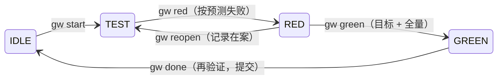

# Gewu Harness · 格物致知

**一个精简的 Claude Code 开发 harness，每个项目都能用：按 SDLC 流程走，每次改动都先红后绿。**

[](https://github.com/yuanliang/gewu-harness/actions/workflows/ci.yml)
[](LICENSE)


[English](README.md) | 简体中文

Gewu 可以装进任何 Git 仓库，只做两件事：

1. **按 SDLC 循环走流程**：遵循 Anthropic《[AI-native SDLC playbook](https://claude.com/resources/articles/the-ai-native-sdlc-playbook)》的“规划 → 设计 → 构建 → 测试 → 交付 → 维护”。每个阶段提交一个产物，每道门禁由人把关。
2. **强制一条规则**：靠 hooks 和计算出来的证据，而不是提示词：

> **没有先被观察到失败的验证，就没有行为改动。**

其他能力，比如 lint、设计系统、部署、团队规范，都由你按需扩展（见[扩展](#扩展)）。

格物致知：知识来自对事物本身的考察，而不是对说法的信任。

> **状态**：0.x，早期版本。核心很小，测试充分，但命令和文件格式在小版本之间仍可能变化，升级前请看[更新日志](CHANGELOG.md)。

## 为什么

AI 写代码的速度早已超过人验证的速度。常见的问题不是代码写得差，而是**没有被验证**：事后补的测试本来就会通过，测试被悄悄改到变绿，没有证据就报告“完成”。Gewu 让诚实的路成为最短的路：

- **先红后绿**：新的验证必须先按你预测的原因失败，实现才会解锁。
- **红之后测试冻结**：只能改代码，不能改测试。测试本身写错了，要显式 `reopen` 并记录在案。
- **证明是算出来的**：`gw` 自己运行检查，每一步对工作区做快照，提交 `[red]` 和 `[green]`，CI 再从历史中重放每一个红。
- **人来决定**：意图、规格、计划由你批准；每次推送、开 PR、合并、发布前，Claude 都必须先问你。

## 快速开始

**环境要求**

- macOS 或 Linux。Windows 请使用 [WSL](https://learn.microsoft.com/windows/wsl/)，因为检查命令通过 `/bin/sh` 执行。
- Node.js 18 或更高版本，以及 Git。
- Claude Code 2.1.295 或更高版本。编辑守卫依赖 hooks 的 `onFailure` 设置，它从这个版本开始提供；在更老的版本上，守卫崩溃时可能放行编辑。`gw doctor` 会检查你的版本。

```bash
git clone https://github.com/yuanliang/gewu-harness.git
node gewu-harness/install.mjs /path/to/your/project
cd /path/to/your/project
.harness/gw doctor --run

# 先看安装器加了什么，再提交，让队友和 CI 用上同一套护栏
git status
git add .harness .claude .github CLAUDE.md REVIEW.md .gitignore
git commit -m "chore: install Gewu Harness"
```

在项目里重启 Claude Code，直接用自然语言说你要做什么，例如：

> 给订单接口加分页，保留旧接口兼容。

Claude 会起草意图、规格和计划交给你批准，然后逐个完成红绿循环，在任何推送之前停下来。

- **升级**：再运行一次安装器。属于你的文件会被合并（`CLAUDE.md`、`.claude/settings.json`、`.gitignore`）或保持不动（配置、评审规则、CI），不会被覆盖。
- **卸载**：`node gewu-harness/install.mjs --uninstall /path/to/your/project` 会精确撤回安装的内容。你改过的文件和 `docs/work/` 里的工作记录会保留。

## 工作方式

### 循环

| 阶段 | 技能 | 产物（`docs/work/<id>/`） | 门禁 |
|---|---|---|---|
| 规划 | `/gw-intent` | `intent.md`：问题、期望结果、**可证伪的**验收信号 | 你批准 |
| 设计 | `/gw-spec` | `spec.md`：每条需求都有 Given/When/Then 检查 | 你批准 |
| 构建 | `/gw-plan` → `/gw-build` | `plan.md`：有序的红绿循环，每个都写出预测的失败 | 你批准 |
| 测试 | 内建于每个循环；bug 用 `/gw-fix` | `evidence.jsonl` 与 `evidence.md` | `gw audit` |
| 交付 | `/gw-review` → `/gw-ship` | 按 `REVIEW.md` 的独立评审；PR 草稿 | 每次推送、PR、合并由你批准 |
| 维护 | `/gw-incident` | 失败的复现测试、一条教训、新的意图 | |

流程随任务大小伸缩：bug 只需批准意图，`quick` 类型不需要任何文档。不确定下一步？用 `/gw-next`。

### 一个循环



| 阶段 | 测试 | 实现 | 离开这个阶段的条件 |
|---|---|---|---|
| IDLE | 锁定 | 锁定 | `start`：没有 `--check` 时，全量测试必须已经是绿的 |
| TEST | 可写 | 锁定 | `red`：有测试改动，检查失败，且按预测失败。崩溃只有用 `--expect` 预测过才算；无法运行的检查永远不算 |
| RED | **冻结** | 可写 | `green`：红之后测试没动过，目标检查和全量测试都通过 |
| GREEN | **冻结** | 可写 | `done`：重构后依然是绿的 |

hooks 会在 `Edit`、`Write` 和 shell 写入时强制这些锁。用其他方式改动的测试，会在 `green` 时被 tree 快照查出（`E_TAMPER`）。

### 可审计的证据

- `[red]` 提交只含新测试；`[green]` 提交含实现和证据链。
- `gw audit --base main` 会列出分支上没有被任何循环验证过的源码改动。
- `gw audit --replay` 在临时 worktree 中，于每个红提交上重跑当时的检查，确认它真的失败，并确认 HEAD 是绿的。你的工作区不会被切换。手改过的证据链过不了重放。安装的 CI 会在每个 PR 上运行它。

## 命令

这些命令由智能体替你执行，你很少需要自己输入。

| 命令 | 作用 |
|---|---|
| `gw start <R#> "<行为>" [--check <命令>] [--expect <文本>]` | 开启循环（TEST） |
| `gw red [--expect <文本>] [--adopt <测试>]` | 证明新检查失败；冻结测试；`[red]` 提交 |
| `gw green` | 证明通过：先目标检查，再全量 |
| `gw done` | 重构后再验证，写证据，`[green]` 提交 |
| `gw reopen "<原因>"` · `gw abort "<原因>"` | 修正写错的测试（回到 TEST）· 放弃当前循环 |
| `gw chore "<原因>"` | 非行为改动；需你确认；全量通过才能结束 |
| `gw new "<标题>" [--type feature\|bug\|incident\|quick]` · `gw use <id>` | 工作项 |
| `gw approve <intent\|spec\|plan>` | **由你执行**：批准当前的确切内容，输入 `! .harness/gw approve plan` |
| `gw status` · `gw evidence` · `gw check` · `gw doctor [--run]` | 查看 |
| `gw audit [--base <ref>] [--replay]` | CI 门禁 |

每个错误都有稳定的错误码（`E_NOT_RED`、`E_WRONG_REASON`、`E_TAMPER`、`E_REGRESSION`、`E_GATE` 等），并告诉你下一步怎么做。

## 配置

`.harness/config.json`：

| 字段 | 默认 | 含义 |
|---|---|---|
| `verify` | 自动识别 | 全量测试命令，退出码 0 为绿。可识别 npm、pnpm、yarn、bun、pytest、Go、Cargo、Mix、RSpec、Maven、Gradle、SwiftPM 和 Make |
| `language` | 取自系统语言 | 工作项模板的语言：`en` 或 `zh-CN` |
| `enforce` | `strict` | `strict` 拦截；`warn` 只提醒智能体；`off` 关闭 hooks |
| `gates` | `warn` | `strict` 时，`start` 要求所需文档已批准且未改动 |
| `commit` | `true` | 只提交本循环涉及的文件，形成 `[red]` / `[green]` 提交 |
| `replaySetup` | `null` | 准备重放用的 worktree，例如 `npm ci`；依赖不在 git 中时必须设置 |
| `postEdit` | `null` | 每次编辑后运行，例如 `npx prettier --write {file}` |
| `testGlobs` / `freeGlobs` / `guardGlobs` | 见文件 | 文件归类为测试、自由（文档）或护栏的规则 |

## 扩展

核心刻意保持精简。其他能力用 Claude Code 自带的扩展点接入，安装器不会碰它们：

- **质量门禁**：串进 `verify`（`npm run lint && npm run typecheck && npm test`），绿就意味着全部通过。
- **技能与子代理**：放在 `.claude/skills/` 和 `.claude/agents/` 下。只有 `gw-*` 开头的名字属于 harness。
- **hooks 与权限**：加进 `.claude/settings.json`，重装时会保留。
- **团队规则**：约定写进项目的 `CLAUDE.md`，评审规则写进 `REVIEW.md`。

## 局限

- **是护栏，不是沙箱**：hooks 和快照拦得住日常的走捷径，拦不住蓄意的恶意执行；配置里的命令以你的权限运行。见 [SECURITY.md](SECURITY.md)。
- **只强制 Claude Code**：其他智能体可以按 `.harness/CLAUDE.md` 的指令行事，但没有任何东西强制它们。
- **管证据，不管品味**：Gewu 证明每个改动做到了它的检查所描述的事；这些检查是否描述了一个好产品，仍由你判断。

## 开发

```bash
npm test    # CLI、hooks、审计与重放、安装与卸载的规格测试
```

## 参与贡献

欢迎贡献，只有一条规则：**拿出你的红**。每个行为改动都要附一个改动前失败、改动后通过的测试。详见 [CONTRIBUTING.md](CONTRIBUTING.md) 和[行为准则](CODE_OF_CONDUCT.md)。

## 致谢

流程遵循 Anthropic 的《[The AI-native SDLC playbook](https://claude.com/resources/articles/the-ai-native-sdlc-playbook)》。本项目是独立项目，与 Anthropic 无关联。

## 许可证

[MIT](LICENSE) © 2026 yuanliang
